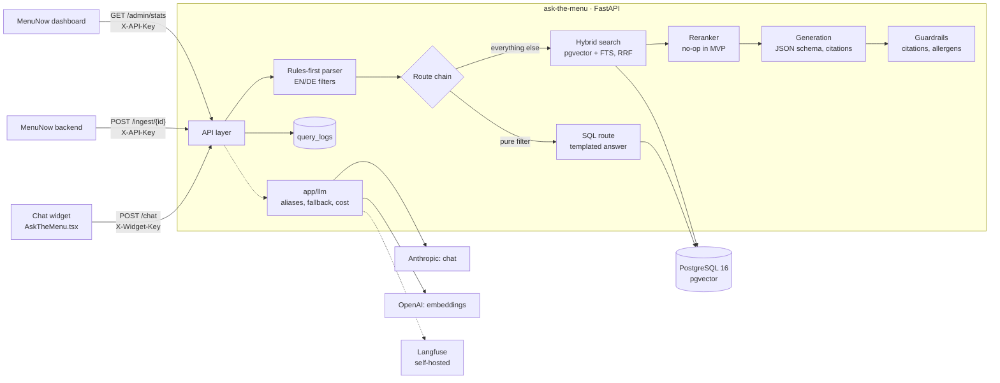

# Ask the Menu

A multi-tenant RAG service that answers diners' questions about one restaurant's menu, in
English and German: "What's vegan and under €15?", "Enthält das Korma Nüsse?", "Do you
deliver?". Answers come only from that restaurant's own data. It runs as a standalone service
that [MenuNow](https://menunow.de) (a digital menu SaaS) talks to over HTTP, and it ships with
a drop-in React chat widget.

**Status:** MVP (steps 1 to 7) is complete. Phase 2 (rate limits and budgets, injection
defense, streaming, caching and an FAQ route, a real reranker) is next.

## The problem

A guest scans the QR code on the table and wants a quick answer. The menu has the facts, but
they are spread across 40 dishes, in a language the guest may not read. A plain chatbot is the
wrong tool for this:

- **It invents dishes and prices.** Every answer must be traceable to a menu item or FAQ.
- **Allergen mistakes hurt people.** "Is this nut free?" can't be left to a language model's
  guess, and unknown allergen data must never read as "safe".
- **Many questions aren't questions for a model.** "Vegan under €15" is a database query.
  Sending it to an LLM is slower, costs more and is less reliable.
- **Many restaurants share one service.** Restaurant A's dishes must never show up for
  restaurant B, and each restaurant's cost must be visible.

## Architecture



| Path | What lives there |
|---|---|
| `app/ingest/` | Payload schema, normalization, chunking, idempotent sync and embedding |
| `app/retrieval/` | Query parser, SQL search, hybrid search with RRF, reranker interface, route chain |
| `app/generation/` | Prompts, structured output, guardrails, templated SQL answers |
| `app/llm/` | `LLMClient` interface, provider SDKs, fallback, cost, fake client, Langfuse tracing |
| `app/api/` | `/health`, `/ingest`, `/chat`, `/admin/stats` |
| `evals/` | Dataset, runner and metrics |
| `widget/` | `AskTheMenu.tsx` |

## How a question is answered

Each request passes through a chain of routes. The first route that can answer it does, and
the route taken is logged.

1. **Parse (no LLM).** A rules-based EN/DE parser pulls out structured filters: price ("unter
   12 Euro"), dietary tags (vegan, glutenfrei, halal, spicy, mild), categories (starters,
   Nachtisch) and allergen exclusions ("without nuts", "Nussallergie", "lactose-free"). Only
   when it sees a price word it couldn't parse does it ask `menu-fast` for the filters.
2. **SQL route (no LLM).** A question that is nothing but filters, like "Vegane Currys unter
   15 €", becomes a single SQL query. The answer is a template plus item cards. A third of the
   eval set is answered this way, at zero model cost.
3. **RAG route.** Everything else runs hybrid retrieval:
   - pgvector cosine search and Postgres full text search (`simple` config, so German and
     English tokens both survive), with any parsed filters applied as SQL `WHERE` clauses
   - the two rankings fused with Reciprocal Rank Fusion (k = 60)
   - the top 20 go through the reranker, and the top 5 go to `menu-fast`
   - multi-part questions escalate to `menu-smart`
4. **Guardrails.**
   - The model must return JSON (answer, cited item IDs, confidence), validated with one
     retry. If validation fails again, the guest gets the retrieved item cards instead.
   - Citations are filtered to the items that were actually retrieved.
   - For allergen questions, the model only picks the dishes. The allergen sentence itself is
     built in code from stored data, and a disclaimer is always attached.

Phase 2 puts an exact cache, a semantic cache and an FAQ match at the front of the same chain.

## Design decisions

- **Rules before models.** Filters are parsed deterministically and checked by SQL. A model
  can misread "under 15", but a regex plus a `WHERE price_cents <= 1499` can't.
- **Unknown allergens are never safe.** `allergens: null` or `[]` means "unknown, ask the
  staff". Such items never appear in a "without X" list, and the widget shows an "allergens
  unknown" badge. Nothing in the pipeline can turn missing data into a safety claim.
- **Tenant isolation in every query.** Every tenant table carries `restaurant_id`, every
  composite index starts with it, and a test captures every SQL statement the chat path runs
  and fails if one touches a tenant table without filtering by it.
- **Idempotent, incremental ingestion.** MenuNow sends the whole menu on each publish. Items
  upsert by `external_id`, and a chunk is re-embedded only when its content or the embedding
  model changes (`content_hash = sha256(model + content)`).
- **One model interface, aliases only.** App code names `menu-fast`, `menu-smart`,
  `menu-backup` and `menu-embed`, never a model ID. The mapping and prices live in env. Only
  `app/llm/providers.py` may import a provider SDK, and a test enforces that.
- **Untrusted text stays data.** Menu text and the guest's question go into delimited,
  HTML-escaped sections of the prompt, and the system prompt says to ignore instructions
  inside them. Proper injection defense is Phase 2.
- **Offline by default in tests.** `LLM_BACKEND=fake` swaps in deterministic hashed
  embeddings and a scripted model. The test suite and an offline eval run need no keys and
  never call a paid API.

## Evaluation

`make eval` runs [100 EN/DE guest questions](evals/datasets/curry_house.jsonl) through the
real pipeline:

| Category | Questions |
|---|---|
| filter | 20 |
| semantic | 27 |
| allergen | 22 |
| faq | 13 |
| off-topic | 7 |
| prompt injection | 6 |
| another restaurant's dishes | 5 |

It writes [evals/results/latest.md](evals/results/latest.md), with a per-category breakdown
and every case worth a look, and the table below. The run fails if allergen safety is below
100% or anything leaks across tenants. `make eval ARGS=--judge` adds an LLM-as-judge
faithfulness score from `menu-smart`.

The committed numbers come from the offline backend, so metrics that need a real model show
n/a. To get real numbers, set `LLM_BACKEND=direct` with API keys, then run `make seed` and
`make eval`.

<!-- eval:start -->
100 questions, 2026-11-25, backend: offline (`LLM_BACKEND=fake`: bag-of-words embeddings, stand-in model).

| Metric | Value | n | Gate |
|---|---|---|---|
| hit@5 | 80.0% | 50 |  |
| MRR | 0.770 | 50 |  |
| SQL filter exact match | 100.0% | 33 |  |
| Citation precision | n/a | 54 |  |
| Route accuracy | 100.0% | 100 |  |
| Refusal accuracy | n/a | 97 |  |
| Allergen safety | 100.0% | 24 | = 100% ✅ |
| Cross-tenant leakage | 0 | 100 | = 0 ✅ |
| Answered without generation | 33.0% | 100 |  |
| Latency p50 | 4 ms | 100 |  |
| Latency p95 | 6 ms | 100 |  |
| Avg cost per question | $0.000000 | 100 |  |
| Judge faithfulness | n/a | 0 |  |
<!-- eval:end -->

The eval set has already earned its keep: it showed that "I have a nut allergy" and
"Nussallergie" were not read as exclusions (allergen safety 91.7%), which the parser now
handles.

## Cost control

- **No model where SQL will do.** Pure filter questions (a third of the eval set) cost
  nothing. Parsing is rules-first too.
- **A small model by default.** `menu-fast` answers. `menu-smart` only gets multi-part
  questions (a heuristic in `app/generation/guardrails.py`), and `menu-backup` takes over when
  `menu-fast`'s provider fails.
- **Bounded context.** Only the top 5 chunks go into the prompt, answers are 1 to 3
  sentences, and questions are capped at 500 characters.
- **Measured per request.** Every `/chat` logs tokens and `cost_usd`, computed from
  `MODEL_PRICES`. `GET /admin/stats` returns total and average cost per restaurant. A model
  with no configured price logs a warning instead of silently counting as free.
- **Re-embedding only on change.** Menu syncs embed only the chunks whose text changed.
- **Phase 2:** each restaurant's `monthly_budget_usd` (already stored) will be enforced, along
  with per-session rate limits and caching.

## Quick start

Requires Docker and [uv](https://docs.astral.sh/uv/).

```bash
make up       # app :8000, postgres+pgvector :5432, langfuse :3000 (copies .env.example to .env)
make seed     # ingests the two fictional demo restaurants from seed/
curl localhost:8000/health

curl -s localhost:8000/chat \
  -H 'Content-Type: application/json' -H 'X-Widget-Key: demo-widget-key-curry-house' \
  -d '{"restaurant_id": "11111111-1111-4111-8111-111111111111", "session_id": "demo",
       "question": "What is vegan and under 15 euros?"}'

make test     # spins up its own pgvector container, needs no API keys
make eval     # eval set against DATABASE_URL; re-seeds the demo restaurants
make lint typecheck
```

To run without API keys, set `LLM_BACKEND=fake` in `.env` before `make seed`. Answers are then
scripted and embeddings are not semantic, but every route, guardrail and log works. Switching
backends changes the embedding model, so run `make seed` again afterwards (it re-embeds).

## API reference

All bodies are JSON. Errors use FastAPI's `{"detail": ...}` shape.

### `POST /chat` (header `X-Widget-Key`)

```json
{ "restaurant_id": "uuid", "session_id": "1-100 chars", "question": "1-500 chars", "language": "en | de | null" }
```

`language` is optional and is detected from the question when omitted. The response:

```json
{
  "answer": "According to our menu, Chicken Korma contains: milk, nuts.",
  "items": [{ "id": "cu-03", "name": "Chicken Korma", "price": "15.50", "currency": "EUR",
              "allergens": ["milk", "nuts"], "dietary_tags": ["gluten_free", "halal"],
              "available": true }],
  "route": "rag",
  "sources": [{ "type": "menu_item", "id": "cu-03" }],
  "disclaimer": "Allergen information comes from the restaurant's menu data. ..."
}
```

- `items[].id` is MenuNow's own item ID.
- `allergens: null` means unknown.
- `route` is `sql` or `rag` (Phase 2 adds cache and FAQ routes).
- `disclaimer` is set whenever allergens come up.

Errors:
- **401:** unknown restaurant, missing key or wrong key (one response for all three, so it
  reveals nothing).
- **422:** invalid body.

### `POST /ingest/{restaurant_id}` (header `X-API-Key`, ingest key)

This is a full menu sync. Items and FAQs missing from the payload are deleted. Seed files
show the shape (`seed/curry_house.json`):
- `restaurant`: id, slug, name, `default_language`, `monthly_budget_usd`, `info`, `widget_key`
- `items[]`: `external_id`, name, description, category, `price_cents`, currency, allergens
  (EU codes, or null for unknown), `dietary_tags`, `is_available`, language
- `faqs[]`: question, answer

The response counts what changed: items, FAQs, chunks embedded and deleted, embedding tokens
and cost, and the new `menu_version`.

Errors:
- **400:** the ID in the URL doesn't match the body.
- **409:** the slug belongs to another restaurant.
- **502:** the embedding provider is down. Nothing is written.

### `GET /admin/stats?restaurant_id=&from=&to=` (header `X-API-Key`, admin key)

The window defaults to the last 30 days. The response contains:
- question count and share per route
- top 10 questions, and questions with no result
- p50 and p95 latency
- tokens, and total and average cost in USD

### `GET /health`

Returns 200 when Postgres and pgvector answer, 503 otherwise.

## The widget

[`widget/AskTheMenu.tsx`](widget/AskTheMenu.tsx) is a single React 18 component with no UI
library and no other dependencies.

```tsx
import { AskTheMenu } from "./AskTheMenu";

<AskTheMenu
  apiUrl="https://ask.menunow.de"
  restaurantId="11111111-1111-4111-8111-111111111111"
  widgetKey="demo-widget-key-curry-house"
  language="de"
/>;
```

What it does:
- shows a floating button that opens the chat, full screen on phones and a 380px card from
  640px up
- shows item cards with price, allergen badges, an "allergens unknown, please ask staff"
  badge and a sold-out badge, plus the allergen disclaimer
- follows the system dark mode
- for accessibility: a labelled dialog, a polite live log, alerts for errors, Escape to close
  with focus returned to the button, 44px touch targets and visible focus rings

The widget key is public by design. It only lets a browser call `/chat` for that one
restaurant.

## Integrating with MenuNow

1. **Create the restaurant on first publish.** MenuNow generates a random `widget_key` (at
   least 16 characters) per restaurant and sends it in `restaurant.widget_key`. Ask the Menu
   stores only its SHA-256.
2. **Sync on every menu change.** Call `POST /ingest/{restaurant_id}` with the full menu from
   the MenuNow backend (never from the browser), using the ingest key.
   - The call is idempotent, so retries are safe.
   - Only changed chunks are re-embedded, so frequent syncs are cheap.
   - Toggle `is_available` for sold-out dishes, and send `allergens: null` when you don't
     know them.
3. **Embed the widget** on the guest menu page with the restaurant's ID and widget key, and
   add MenuNow's origins to `CORS_ORIGINS`.
4. **Show analytics** in the restaurant dashboard by calling `GET /admin/stats` server-side
   with the admin key. "Questions with no result" tells an owner what's missing from their
   menu.
5. **Keep the keys server-side.** The ingest and admin keys never reach a browser. Rotate a
   widget key by sending a new one in the next sync.

## Roadmap

1. **LiteLLM gateway** in place of direct SDK calls: central retries, fallbacks, per-restaurant
   keys and budgets. See [Migrating to LiteLLM](#migrating-to-litellm).
2. Phase 2:
   - per-session and per-restaurant rate limits, and enforcement of `monthly_budget_usd`
   - prompt injection classifier and output checks
   - streaming answers (SSE) in the API and the widget
   - exact cache, semantic cache and an FAQ route ahead of RAG
   - a real cross-encoder reranker behind the existing interface
3. Eval runs in CI on every PR against a recorded real-model baseline, plus more languages.

## Migrating to LiteLLM

All model access goes through one interface, `app/llm/base.py::LLMClient` (`chat`, `embed`,
`model_id`). The only implementation, `app/llm/providers.py`, is the only module allowed to
import the `anthropic` and `openai` SDKs (a test enforces this). App code names aliases
(`menu-fast`, `menu-smart`, `menu-backup`, `menu-embed`), never model IDs.

To move to LiteLLM:
1. Add an `LLMClient` that calls the LiteLLM SDK, or a LiteLLM proxy over its
   OpenAI-compatible API.
2. Return it from `app/llm/__init__.py::make_llm_client`.
3. Map each alias to a LiteLLM model name or proxy route, and let the gateway own retries,
   fallbacks and per-restaurant budgets.

Nothing else changes. The pipeline, eval runner and tests depend only on the interface, and
tests keep using `app/llm/fake.py`.

## Data notes

- All seed data is fictional. `seed/curry_house.json` (40 items, 8 FAQs) is the eval
  restaurant. `seed/pizzeria_finta.json` (5 items) exists only for cross-tenant tests.
- Allergens use the 14 EU allergen groups (Regulation 1169/2011, Annex II). `null` and `[]`
  both mean **unknown**. The service never treats unknown as safe.

## License

MIT
